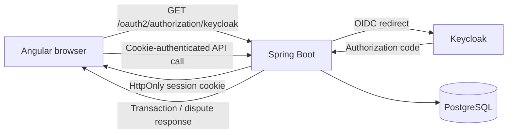

# Capitec Transactions Dispute Portal

This compact full-stack demo meets the assessment brief: a customer authenticates, sees transaction history, submits a dispute, and can see its open status. It uses an Angular UI, Spring Boot API, Keycloak OpenID Connect authentication, and PostgreSQL. The API, Keycloak, and database run in Docker.



## Run locally

1. Start the Docker-backed services:

   ```bash
   docker compose up --build
   ```

2. In another terminal, start the UI:

   ```bash
   cd portal-ui
   npm install
   npm start
   ```

3. Open `http://localhost:4200` and sign in with `customer` / `customer`.

The UI automatically calls `GET /api/transactions` after sign-in and displays the seeded transactions. Select **Dispute** on a posted transaction, provide a reason, and submit it. The transaction changes to **Dispute open** and the record is stored in PostgreSQL.

## Services

| Service | Address | Purpose |
| --- | --- | --- |
| Angular UI | http://localhost:4200 | Customer transaction and dispute experience |
| Spring Boot API | http://localhost:8080 | Authenticated transactions and dispute API |
| Keycloak | http://localhost:8081 | Local OpenID Connect identity provider |
| PostgreSQL | localhost:5432 | Transaction and dispute persistence |

The API exposes:

- `GET /api/health` — public health check
- `GET /api/transactions` — authenticated transaction history
- `GET /api/disputes` — authenticated disputes
- `POST /api/transactions/{id}/disputes` — authenticated dispute creation

## Tests and builds

```bash
mvn test
mvn package
cd portal-ui && npm test -- --browsers=ChromeHeadless && npm run build
```

Current coverage includes six focused Java unit/controller tests and three Angular component/API tests. The final live verification exercised the OAuth login flow, transaction retrieval, dispute creation (`201 Created`), and persisted dispute retrieval from PostgreSQL.

## Demo security notes

- OAuth 2.0 authorization-code flow with OIDC; Keycloak is a local development identity provider.
- Spring Security holds the authenticated browser session; the UI never receives an access token.
- The demo permits the local Angular origin only and validates non-blank dispute reasons.
- CSRF is disabled only to keep the local, reverse-proxied demo small. A production deployment must enable CSRF, use HTTPS-only secure cookies, rotate credentials, use managed PostgreSQL, and apply database migrations such as Flyway.
