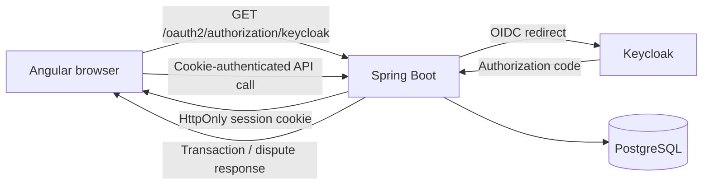

# Transactions Dispute Portal

A production-minded Capitec technical-assessment solution: customers sign in using OAuth 2.0 / OpenID Connect, review transactions and create disputes. The browser never receives an access token; Spring Security holds the authenticated session in an `HttpOnly`, `Secure` (in production), `SameSite=Lax` cookie.



## Run

1. Start `docker compose up --build`.
2. In a second terminal, run `cd portal-ui && npm install && npm start`.
3. Open `http://localhost:4200`, select **Sign in securely**, and use `customer` / `customer`.

## Test and build

```bash
mvn test
mvn package
cd portal-ui && npm test && npm run build
```

## Security decisions

- OAuth 2.0 authorization-code flow with OIDC; Keycloak is a local development identity provider.
- Session cookie has `HttpOnly`, `SameSite=Lax`, and `Secure=true` when deployed behind HTTPS.
- CSRF defence is enabled; the Angular app must return the `XSRF-TOKEN` cookie in state-changing requests.
- API is CORS-restricted to the configured web origin and validates dispute reasons.
- Production deployment should put the API behind TLS, rotate client credentials, use a managed PostgreSQL service, and apply Flyway migrations.
